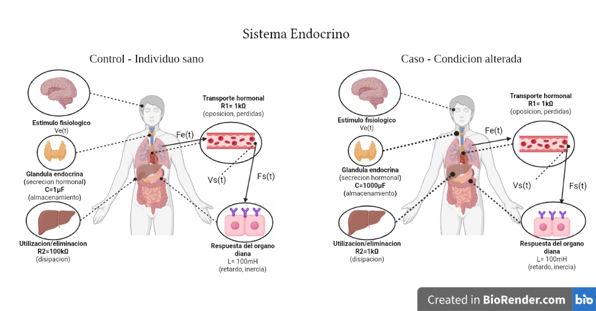
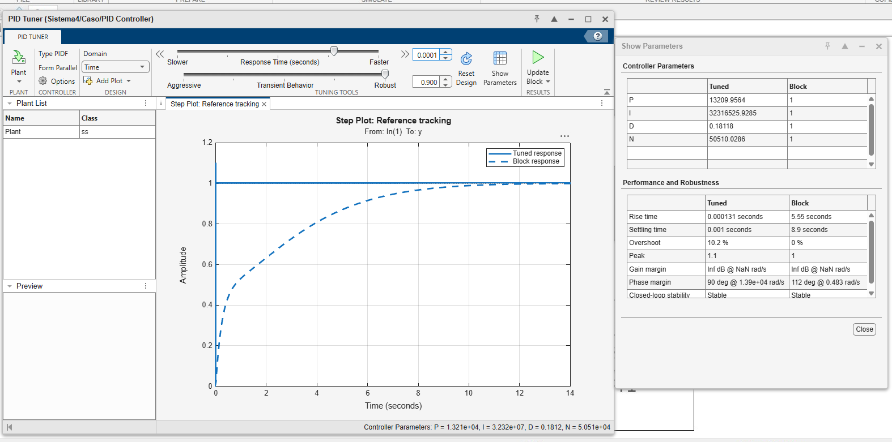
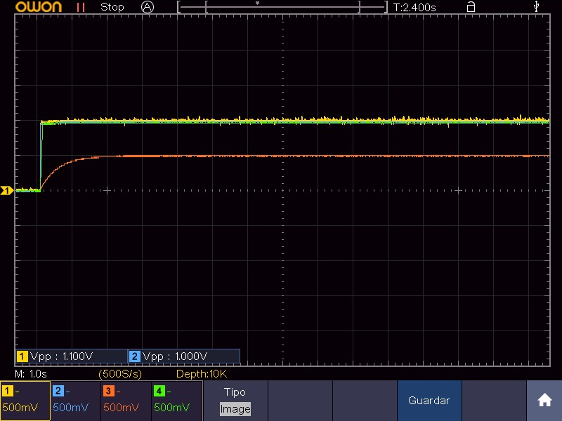

# Práctica 4 — Modelado y control del sistema endocrino

En esta práctica se representa la señal hormonal disponible en un tejido mediante el voltaje de un circuito RLC. Se estudian tres respuestas ante el mismo estímulo: la de un individuo sano (control), la de una condición alterada (caso) y la del caso con un controlador PID que toma la respuesta sana como referencia.

**Docente:** Dr. Paul Antonio Valle Trujillo  
**Correo del docente:** paul.valle@tectijuana.edu.mx  
**Departamento:** Ingeniería Eléctrica y Electrónica  
**Institución:** Tecnológico Nacional de México / Instituto Tecnológico de Tijuana  
**Asignatura:** Modelado de Sistemas Fisiológicos  
**Programa:** Ingeniería Biomédica  
**Estudiante:** Marcos Ancelmo Naranjo Rivera  
**Número de control:** 23212218  
**Correo institucional:** l23212218@tectijuana.edu.mx

**Sede:** Blvd. Alberto Limón Padilla s/n, Tijuana, C. P. 22454, B. C., México.  
**Material de la asignatura:** Apartado 5.6, *Modelado y control del sistema endócrino*.

---

## Contenido

1. [Resumen](#resumen)
2. [Competencia y objetivos](#competencia-y-objetivos)
3. [Modelo fisiológico y analogía eléctrica](#modelo-fisiológico-y-analogía-eléctrica)
4. [Formulación matemática](#formulación-matemática)
5. [Estabilidad y respuesta al escalón](#estabilidad-y-respuesta-al-escalón)
6. [Implementación en MATLAB y Simulink](#implementación-en-matlab-y-simulink)
7. [Control del caso y sintonización PID](#control-del-caso-y-sintonización-pid)
8. [Implementación en Python](#implementación-en-python)
9. [Resultados de simulación y laboratorio](#resultados-de-simulación-y-laboratorio)
10. [Archivos del repositorio](#archivos-del-repositorio)
11. [Cómo reproducir la práctica](#cómo-reproducir-la-práctica)
12. [Conclusiones](#conclusiones)
13. [Referencias](#referencias)

## Resumen

Ante un escalón de 1 V, el modelo del individuo sano alcanza 0.9901 V en estado estacionario. Al aumentar la capacitancia de 1 a 1000 µF y reducir la resistencia de salida de 100 a 1 kΩ, el caso tarda cerca de 2 s en completar el 98 % de su respuesta y se estabiliza en 0.5000 V. Las simulaciones en MATLAB/Simulink y Python muestran que, al incorporar el PID, el caso sigue la trayectoria del control. En el osciloscopio se distingue el ascenso gradual de la señal de menor amplitud, tal como predice el modelo en lazo abierto.

**Palabras clave:** sistema endocrino, analogía eléctrica, función de transferencia, respuesta al escalón, control PID, retroalimentación negativa.

## Competencia y objetivos

**Competencia.** Representar un proceso fisiológico mediante un circuito equivalente, formular las ecuaciones que describen su dinámica y evaluar una estrategia de control mediante simulación y evidencia experimental.

**Objetivo general.** Comparar las respuestas del control y del caso, y evaluar si un controlador PID permite que el caso siga la trayectoria de la condición de referencia.

| Objetivo específico | Relación con los temas de la asignatura |
|---|---|
| Identificar el estímulo, los flujos y el nivel hormonal de salida | Representación de un proceso fisiológico mediante variables eléctricas |
| Obtener las ecuaciones y la función de transferencia | Leyes de Kirchhoff, transformada de Laplace y modelos de segundo orden |
| Predecir el valor final y la rapidez de respuesta | Ganancia estática, polos y respuesta temporal |
| Evaluar el seguimiento del caso con PID | Retroalimentación negativa y sintonización |
| Contrastar los resultados calculados con las gráficas y el osciloscopio | Simulación y verificación experimental |

## Modelo fisiológico y analogía eléctrica



**Figura 1.** El estímulo activa la secreción hormonal. Una parte del flujo se acumula temporalmente y otra llega al tejido diana. El diagrama muestra los dos cambios introducidos en el caso: el aumento de la capacitancia y la disminución de la resistencia de utilización o eliminación.

| Símbolo | Representación en el circuito | Interpretación fisiológica |
|---|---|---|
| $V_e(t)$ | Fuente de voltaje | Estímulo que activa la secreción hormonal |
| $F_e(t)$ | Corriente que atraviesa $R_1$ | Flujo de secreción y transporte hacia el compartimento |
| $R_1$ | Resistencia de entrada | Oposición y pérdidas durante el transporte |
| $C$ | Capacitor entre el nodo de salida y la referencia | Capacidad de almacenamiento temporal de la hormona |
| $L$ | Inductor en la rama del tejido diana | Inercia de la respuesta ante cambios rápidos |
| $R_2$ | Resistencia en serie con el inductor | Utilización, disipación o eliminación de la señal |
| $F_s(t)$ | Corriente por la rama $L$–$R_2$ | Flujo asociado con la respuesta del tejido diana |
| $V_s(t)$ | Voltaje del nodo común a $R_1$, $C$ y $L$, medido respecto a la referencia | Nivel hormonal efectivo normalizado |

La fuente alimenta a $R_1$. Después de esta resistencia, la corriente se divide entre el capacitor y la rama serie formada por $L$ y $R_2$. La salida se mide sobre el capacitor. La siguiente tabla reúne los parámetros del instructivo y de las funciones de transferencia en Simulink.

| Componente | Control | Caso |
|---|---:|---:|
| $R_1$ | 1 kΩ | 1 kΩ |
| $L$ | 100 mH | 100 mH |
| $C$ | 1 µF | 1000 µF |
| $R_2$ | 100 kΩ | 1 kΩ |

## Formulación matemática

Por la ley de voltajes en la entrada, la corriente que llega al nodo es

$$
F_e(t)=\frac{V_e(t)-V_s(t)}{R_1}.
$$

La corriente del capacitor es la diferencia entre el flujo de entrada y el flujo que continúa hacia el tejido. La tensión del nodo también es igual a la suma de las caídas en el inductor y en $R_2$. Con condiciones iniciales nulas se obtiene

$$
V_s(t)=\frac{1}{C}\int_0^t [F_e(\tau)-F_s(\tau)]\,d\tau,
\qquad
V_s(t)=L\frac{dF_s(t)}{dt}+R_2 F_s(t).
$$

Al tomar $V_s$ y $F_s$ como variables de estado, las ecuaciones para simulación quedan como

$$
\frac{dV_s}{dt}=\frac{V_e-V_s}{R_1 C}-\frac{F_s}{C},
\qquad
\frac{dF_s}{dt}=\frac{V_s-R_2F_s}{L}.
$$

En el dominio de Laplace, $F_e(s)=CsV_s(s)+F_s(s)$ y $V_s(s)=(Ls+R_2)F_s(s)$. Al sustituir ambas relaciones en $V_e(s)=R_1F_e(s)+V_s(s)$ resulta

$$
G(s)=\frac{V_s(s)}{V_e(s)}
=\frac{Ls+R_2}{R_1CLs^2+(R_1CR_2+L)s+(R_1+R_2)}.
$$

Con $L=0.1$ H, las funciones de transferencia cargadas en Simulink son

$$
G_{\mathrm{control}}(s)=\frac{0.1s+100000}{0.0001s^2+100.1s+101000}.
$$

$$
G_{\mathrm{caso}}(s)=\frac{0.1s+1000}{0.1s^2+1000.1s+2000}.
$$

El desarrollo manuscrito contiene los circuitos, la formulación por corrientes y el bosquejo temporal. Las expresiones numéricas anteriores se obtuvieron sustituyendo los parámetros en unidades SI y coinciden con los bloques de transferencia del modelo. [Consultar el análisis matemático](Naranajo23212218_4analisismatematico.pdf).

## Estabilidad y respuesta al escalón

En estado estacionario, el capacitor deja de conducir corriente y la caída de voltaje en el inductor es cero. La salida queda determinada por el divisor formado por $R_1$ y $R_2$. Para un escalón de 1 V, $V_s(\infty)=G(0)\,(1\,\mathrm{V})$, con $G(0)=R_2/(R_1+R_2)$.

| Magnitud calculada para $L=100$ mH | Control | Caso |
|---|---:|---:|
| Salida final | 0.9901 V | 0.5000 V |
| Diferencia final respecto a la entrada de 1 V | 0.0099 V | 0.5000 V |
| Polos aproximados (s⁻¹) | −999 990 y −1010.01 | −9999.00 y −2.0002 |
| Constante de tiempo dominante | 0.990 ms | 0.500 s |

Los dos pares de polos son reales, negativos y distintos. Ambas plantas son estables y sobreamortiguadas. El polo dominante del caso, cercano a −2 s⁻¹, explica por qué la curva tarda alrededor de 2 s en recorrer el 98 % del cambio. Al inicio del escalón, el capacitor está descargado y la corriente del inductor es cero. En ese instante la pendiente de salida es $1/(R_1 C)$ para la entrada de 1 V: 1000 V/s en el control y 1 V/s en el caso. Esa diferencia explica por qué, al graficar los primeros segundos, el ascenso del control parece casi vertical. La caída del nivel final se explica por la reducción de $R_2$, que cambia la proporción del voltaje disponible en la salida.

## Implementación en MATLAB y Simulink

El modelo contiene subsistemas de control y caso con representaciones por función de transferencia y ecuaciones integro-diferenciales. El subsistema del caso también contiene el lazo con el controlador. El bloque **Step** aplica un escalón de 1 V en $t=0$ para comparar las respuestas del control, del caso y del caso con PID.

| Configuración del cuaderno | Valor |
|---|---|
| Modelo | `Sistema4.slx` |
| Duración | 10 s |
| Solver | `ode15s` |
| Paso máximo | 0.001 s |
| Tiempo y señales exportadas | `t`, `Ve`, `Vsx` (control), `Vsy` (caso), `VsPID` (caso con PID) |

La función local `plotsignals` coloca las cuatro señales en los mismos ejes y exporta la figura como PDF vectorial. El eje vertical representa voltajes, tanto para la entrada como para las tres salidas. [Cuaderno de MATLAB en PDF](Naranjo23212218_4.pdf) · [Gráfica de MATLAB](Control_caso_matlab4.pdf).

## Control del caso y sintonización PID

El lazo utiliza como referencia $r(t)=V_{s,\mathrm{control}}(t)$. El controlador recibe el error entre esa referencia y la salida realimentada del caso. Así, el objetivo final del seguimiento es aproximadamente **0.9901 V** para el estímulo de 1 V. Con realimentación unitaria negativa, la función de transferencia de referencia a salida es

$$
T(s)=\frac{K(s)G_{\mathrm{caso}}(s)}{1+K(s)G_{\mathrm{caso}}(s)}.
$$



**Figura 2.** PID Tuner muestra un PID paralelo con filtro derivativo (PIDF). La columna *Tuned* muestra los parámetros de sintonización.

| Parámetro | Valor |
|---|---:|
| Proporcional $K_P$ | 13209.9564 |
| Integral $K_I$ | 32316525.9285 |
| Derivativo $K_D$ | 0.18118 |
| Coeficiente del filtro $N$ | 50510.0286 |

Para el **escalón de referencia del sintonizador**, la captura reporta un tiempo de subida de 0.000131 s, un tiempo de establecimiento de 0.001 s y un sobreimpulso de 10.2 %. Estas métricas describen la prueba interna de PID Tuner. En la gráfica completa de la práctica se aplica como referencia la trayectoria del control y se muestran 10 s, por lo que el transitorio inicial se aprecia a una escala diferente.

## Implementación en Python

El script utiliza una inductancia de **100 mH** (0.1 H) en el control y en el caso. Forma las dos plantas con `control.tf`, calcula sus respuestas con `forced_response` y cierra el lazo del caso con `feedback`. La salida del control alimenta la simulación del caso con PID. El vector temporal va de 0 a 10 s con 10 001 muestras y una separación de 1 ms.

Para el controlador analógico se fija $C_r=1$ nF. A partir de las ganancias de la columna *Tuned*, el script calcula $R_e=1/(C_r K_I)$, $R_r=K_P R_e$ y $C_e=K_D/R_r$. Los valores resultantes son $R_e\approx30.94$ Ω, $R_r\approx408.77$ kΩ y $C_e\approx443.23$ nF. La función implementada es

$$
K_{\mathrm{Python}}(s)=
\frac{R_eR_rC_eC_rs^2+(R_eC_e+R_rC_r)s+1}{R_eC_rs}.
$$

[Código de Python](Naranjo23212218_4.py) · [Gráfica de Python](Control_caso_python4.pdf).

## Resultados de simulación y laboratorio

### Lectura de las gráficas

En las dos simulaciones, la línea verde representa el estímulo de 1 V. La curva azul corresponde al individuo sano y sirve de referencia para el controlador. Para interpretar las líneas discontinuas conviene observar primero el ascenso inicial y después la separación entre sus niveles finales.

| Señal | Durante el transitorio | Al estabilizarse |
|---|---|---|
| Control (azul) | Sube en pocos milisegundos. A la escala de 10 s, la subida parece vertical. | Llega a 0.9901 V, ligeramente por debajo de la entrada. |
| Caso en lazo abierto (violeta) | Presenta una subida gradual que se distingue durante los primeros 2 s. | Llega a 0.5000 V y queda aproximadamente 0.49 V por debajo del control. |
| Caso con PID (rojo) | Sigue la trayectoria azul. Ambas curvas quedan prácticamente superpuestas a la escala de la figura. | Se aproxima a 0.99 V, el nivel de referencia. |

Cada gráfica reúne las cuatro señales sobre los mismos ejes. [Resultado en MATLAB/Simulink](Control_caso_matlab4.pdf) · [Resultado en Python](Control_caso_python4.pdf).

### Registro experimental



**Figura 3.** Respuesta registrada con una base de tiempo de 1 s/div y una escala vertical de 500 mV/div. Tomando como origen el nivel previo al escalón, las trazas superiores suben cerca de dos divisiones (1 V). La traza naranja sube una división (0.5 V) y se aproxima gradualmente a ese nivel. Su amplitud y su forma concuerdan con la predicción para el caso en lazo abierto.

Las lecturas automáticas de CH1 (1.100 Vpp) y CH2 (1.000 Vpp) corresponden al voltaje pico a pico de esos canales. Para comparar el nivel final con el modelo se utilizó el desplazamiento vertical desde la línea inicial hasta la meseta.

## Archivos del repositorio

Los enlaces corresponden a los nombres originales y suponen que los archivos están junto a este README.

| Archivo | Contenido |
|---|---|
| [Naranajo23212218_4analisismatematico.pdf](Naranajo23212218_4analisismatematico.pdf) | Circuitos, ecuaciones, transformada de Laplace, estabilidad y bosquejo |
| [Naranjo23212218_4diagramafisiologico.png](Naranjo23212218_4diagramafisiologico.png) | Diagrama fisiológico del control y del caso |
| [Sistema4.slx](Sistema4.slx) | Modelo ejecutable de Simulink |
| [Naranjo23212218_4.mlx](Naranjo23212218_4.mlx) | Cuaderno ejecutable de MATLAB |
| [Naranjo23212218_4.pdf](Naranjo23212218_4.pdf) | Versión del cuaderno para consulta |
| [Control_caso_matlab4.pdf](Control_caso_matlab4.pdf) | Comparación de las cuatro señales en MATLAB |
| [Parametroscontrolador4.png](Parametroscontrolador4.png) | Ganancias y métricas de PID Tuner |
| [Naranjo23212218_4.py](Naranjo23212218_4.py) | Simulación en Python y cálculo de componentes del controlador |
| [Control_caso_python4.pdf](Control_caso_python4.pdf) | Comparación de las cuatro señales en Python |
| [Control_caso_lab4.jpeg](Control_caso_lab4.jpeg) | Captura experimental del osciloscopio |

## Cómo reproducir la práctica

1. Descargar los archivos conservando sus nombres y colocarlos en una misma carpeta. El cuaderno abre el modelo por el nombre `Sistema4`.
2. En MATLAB con Simulink, seleccionar esa carpeta como directorio actual, abrir `Naranjo23212218_4.mlx` y ejecutar todas las secciones. El archivo del modelo fue guardado en **R2026b Update 1**. Para repetir la sintonización se requiere acceso a PID Tuner.
3. Revisar las señales `Ve`, `Vsx`, `Vsy` y `VsPID`. La última sección del cuaderno genera `Control_caso_matlab4.pdf`.
4. Para reproducir la segunda simulación con Python 3, ejecutar desde esa misma carpeta:

   ```bash
   python -m pip install numpy matplotlib control
   python Naranjo23212218_4.py
   ```

5. Cerrar la ventana de la gráfica para que el script termine la exportación de `Control_caso_python4.pdf`. Comparar ambos PDF con la captura de laboratorio, empezando por los niveles finales y después por la rapidez de la subida. Al ejecutar los programas, los PDF de salida se escriben con los mismos nombres que las evidencias entregadas.

## Conclusiones

El circuito permite explicar por separado la rapidez de la respuesta y el nivel que alcanza la salida. Al inicio, el capacitor de 1000 µF del caso se carga con una pendiente mil veces menor que el de 1 µF del control. En estado estacionario, la división de voltaje entre las dos resistencias de 1 kΩ deja exactamente la mitad del estímulo a la salida. La meseta de aproximadamente 0.5 V que se aprecia en el osciloscopio concuerda con ese cálculo.

En las simulaciones, la separación final de aproximadamente 0.49 V entre el caso y el control se reduce al cerrar el lazo. El PID actúa sobre el error respecto a la trayectoria sana, de modo que la salida del caso sigue tanto su evolución temporal como su nivel final cercano a 0.99 V.

## Referencias

1. Valle Trujillo, P. A. *Modelado de Sistemas Fisiológicos*, apartado 5.6, «Práctica: Modelado y control del sistema endócrino», pp. 96–105. Tecnológico Nacional de México / Instituto Tecnológico de Tijuana. Material de la asignatura.
2. Naranjo Rivera, M. A. *Práctica cuatro: Modelado y control del sistema endocrino*. Cuaderno computacional y desarrollo analítico de la práctica. [Cuaderno](Naranjo23212218_4.pdf) · [Desarrollo manuscrito](Naranajo23212218_4analisismatematico.pdf).

[Volver al contenido](#contenido)
